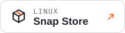
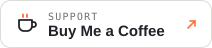
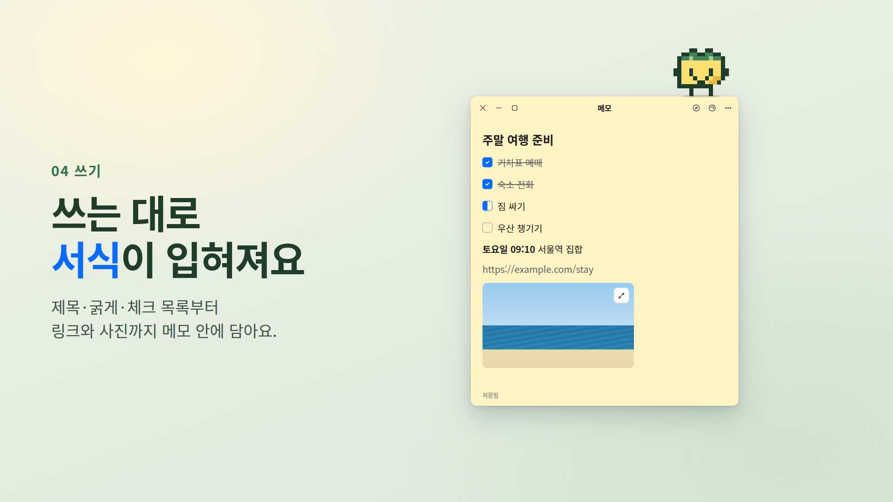
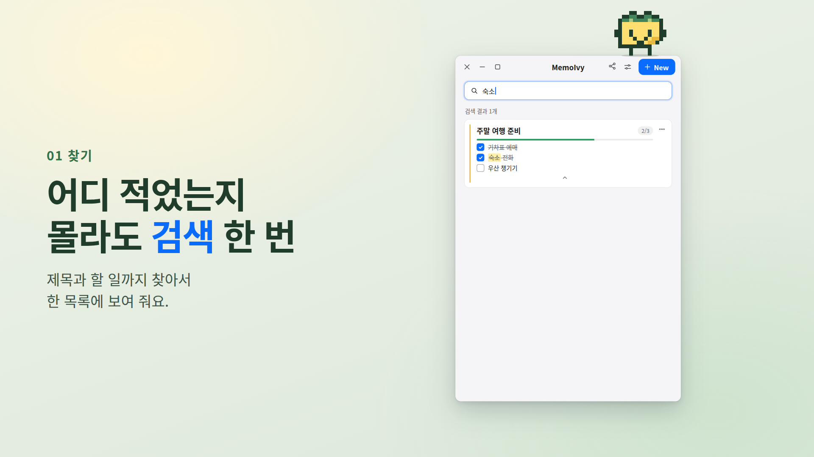
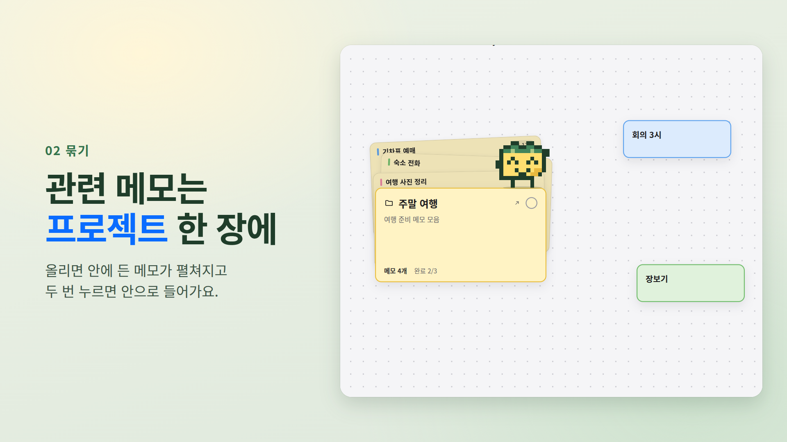
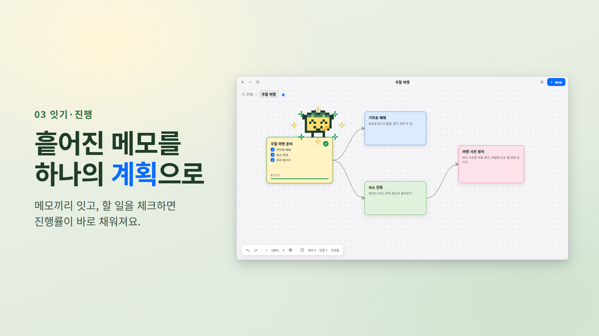
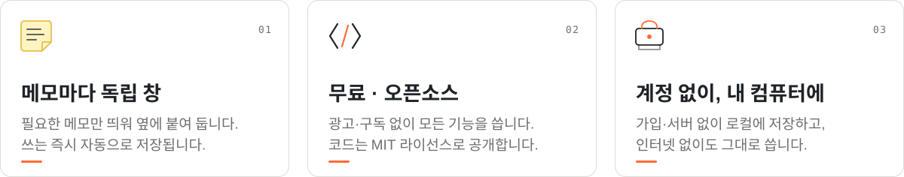
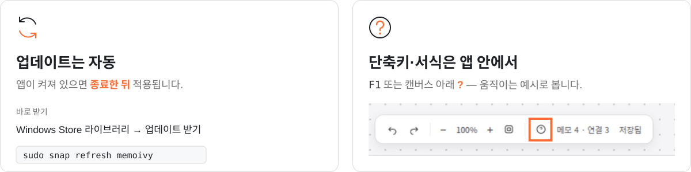

<h1 align="center"><br>MemoIvy</h1>

<p align="center"><strong>바탕화면에 붙여 두는 스티커 메모, 그리고 그 메모를 잇는 캔버스</strong><br>작은 메모에서, 연결된 생각으로.</p>

<p align="center"><sub>무료 · 오픈소스(MIT) · Windows · Linux</sub></p>

<p align="center">
<a href="https://apps.microsoft.com/detail/9P4QJZCXFDJV"><picture><source media="(prefers-color-scheme: dark)" srcset=".github/readme/ms-store-dark.svg"></picture></a>&nbsp;
<a href="https://snapcraft.io/memoivy"><picture><source media="(prefers-color-scheme: dark)" srcset=".github/readme/snap-store-dark.svg"></picture></a>&nbsp;
<a href="https://buymeacoffee.com/oneulCreator"><picture><source media="(prefers-color-scheme: dark)" srcset=".github/readme/coffee-dark.svg"></picture></a>
</p>

<p align="center"></p>

<table>
<tr>
<td width="33%" valign="top"><br><b>찾기</b><br>할 일까지 한 번에 검색</td>
<td width="33%" valign="top"><br><b>묶기</b><br>프로젝트 한 장으로</td>
<td width="33%" valign="top"><br><b>잇기</b><br>메모를 이어 계획으로</td>
</tr>
</table>

## 특징

<picture><source media="(prefers-color-scheme: dark)" srcset=".github/readme/features-dark.svg"></picture>

## 설치

- **Windows** — [Microsoft Store](https://apps.microsoft.com/detail/9P4QJZCXFDJV)에서 설치합니다.
- **Linux** — [Snap Store](https://snapcraft.io/memoivy)에서 설치하거나 터미널에서 실행합니다.

```bash
sudo snap install memoivy
```

<details>
<summary>“스토어에서 알 수 없음” 오류가 날 때</summary>

로컬 `.snap`으로 설치한 경우입니다. 한 번만 Store 배포본으로 전환하세요.

```bash
sudo snap refresh memoivy --amend --channel=stable
```

</details>

<picture><source media="(prefers-color-scheme: dark)" srcset=".github/readme/tips-dark.svg"></picture>

데이터 위치와 백업은 `docs`에서 **백업·복원**(OPS-002)으로 찾으세요.

## 개발

Electron · React · Rust · SQLite. **mise**로 Node·Rust 버전을 맞춥니다.

```bash
mise install && npm ci && mise run dev
```

<details>
<summary>빌드·검증 명령</summary>

| 작업 | 명령 |
| --- | --- |
| 화면별 상태 보기 | `mise run storybook` |
| 앱 메뉴·바탕화면에 설치 | `mise run install` |
| 화면 타입 검사 | `npm run typecheck` |
| 저장 엔진 검증 | `mise run test:engine` |
| 릴리스 빌드 | `mise run build` |
| 커밋·푸시 비밀정보 검사 켜기 | `mise run hooks:install` |

상세 안내는 `docs`에서 **설치**(OPS-001), **개발 검증**(OPS-003), **아키텍처** 관심사로 찾으세요.

</details>

## 후원

<a href="https://buymeacoffee.com/oneulCreator"><picture><source media="(prefers-color-scheme: dark)" srcset=".github/readme/support-dark.svg"></picture></a>

[버그 제보·기능 제안](https://github.com/pollux-o4/MemoIvy/issues) · [MIT License](LICENSE)
