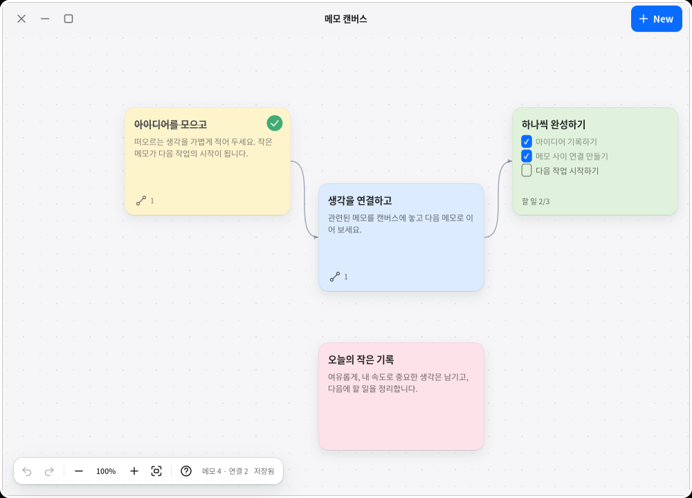
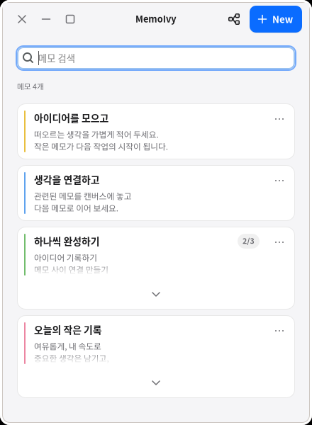

<h1 align="center"> MemoIvy</h1>

<p align="center"><strong>적고 · 묶고 · 연결하는 Linux 메모 앱</strong><br>작은 메모에서, 연결된 생각으로.</p>
<p align="center"><a href="#시작하기">시작하기</a> · <a href="#화면-살펴보기">화면 살펴보기</a> · <a href="https://github.com/pollux-o4/MemoIvy/issues">문제 제보</a></p>

- **적기** — Markdown·체크리스트·이미지·파일, 독립 편집 창과 자동 저장.
- **모으기** — 목록 검색·본문 펼침, 프로젝트와 하위 프로젝트로 정리.
- **연결하기** — 캔버스 배치·연결·정렬, 변경 되돌리기와 다시 실행.

<p align="center">
  <a href="docs/assets/canvas.png"></a><br>
  <sub>실제 개발 버전 · 합성 메모 · 클릭하면 크게 보기</sub>
</p>

## 시작하기

### Snap 설치·업데이트

[Snap Store에서 설치](https://snapcraft.io/memoivy)하거나 터미널에서 실행하세요. 배포판에 **snapd**가 필요합니다.

```bash
# 처음 설치
sudo snap install memoivy

# 설치된 앱 업데이트
sudo snap refresh memoivy

# 실행
snap run memoivy
```

이전에 로컬 `.snap` 파일로 설치해 “스토어에서 알 수 없음” 오류가 나면, 한 번만 Store 배포본으로 전환하세요.

```bash
sudo snap refresh memoivy --amend --channel=stable
```

Snap은 자동 업데이트도 지원합니다. 수동 업데이트 전에는 앱을 정상 종료하고, 완료 후 다시 열어 주세요.

일반 설치에서 Snap으로 바꾸면 데이터 저장 영역이 달라 기존 메모가 자동으로 나타나지 않습니다. 전환 전 **백업·복원**(OPS-002) 절차를 확인하세요.

<details>
<summary>소스에서 실행·설치하기 (개발용)</summary>

개발 버전은 Electron·React 화면과 Rust·SQLite 엔진으로 이관 중입니다. **mise**로 Node와 Rust 버전을 맞춥니다. Windows·macOS는 해당 환경의 검수를 진행한 범위만 지원 완료로 기록합니다.

```bash
# 개발 의존성 설치 후 실행
mise install
npm ci
mise run dev

# 화면별 상태와 GTK 원본 비교
mise run storybook
```

앱 메뉴와 바탕화면에 설치하거나 기존 설치본을 갱신하려면:

```bash
mise run install
```

실행 중인 MemoIvy는 종료한 뒤 다시 열어 주세요.

원본 GTK 화면·합성 데이터·캡처 메타정보는 **UI-REF-001**로 검색합니다. Storybook의 `Reference/GTK Fidelity`에서 같은 조건으로 비교하며 기준 이미지는 일반 빌드·테스트에서 갱신하지 않습니다. GTK 비교 실행은 별도 시스템 GTK 개발 패키지를 설치한 환경에서 `mise run dev:legacy`로 진행합니다.

</details>

## 화면 살펴보기

<details>
<summary><strong>목록</strong> — 메모를 검색하고 본문 펼쳐 읽기</summary>

긴 본문은 목록 안에서 펼치고 접습니다. 관련 메모는 프로젝트로 묶고 하위 프로젝트로 나눕니다.



</details>

<details>
<summary><strong>캔버스</strong> — 메모를 배치하고 다음 작업 연결하기</summary>

카드를 끌어 배치하고 다음 메모를 연결합니다. 여러 카드를 선택해 정렬하거나 간격을 맞추고, 배치·연결·완료 변경을 되돌릴 수 있습니다. 카드를 두 번 누르면 원본 메모가 열립니다.


</details>

<details>
<summary><strong>단축키</strong> — 자주 쓰는 조작 빠르게 확인하기</summary>

| 하고 싶은 일 | 조작 |
| --- | --- |
| 앱·서식 단축키 확인 | `F1` |
| 체크 항목 완료·해제 | 체크박스 클릭 또는 `Ctrl+Enter` |
| 링크 열기 | `Ctrl+클릭` · 마우스를 올리면 실제 주소 표시 |
| Markdown 원문 전환 | `Ctrl+Shift+M` 또는 더보기 메뉴 |
| 캔버스에서 여러 카드 선택 | 빈 곳에서 끌기 |
| 선택한 캔버스 메모 삭제 | `Delete` → 확인 후 삭제 |

</details>

## 개발·검증

Electron · React · Rust · SQLite · MIT License

<details>
<summary>빌드·테스트·Snap 패키징 명령</summary>

| 작업 | 명령 |
| --- | --- |
| 화면 타입 검사 | `npm run typecheck` |
| 저장 엔진 검증 | `mise run test:engine` |
| Storybook 빌드 | `npm run build:storybook` |
| 릴리스 빌드 | `mise run build` |
| 현재 운영체제 설치 패키지 | `npm run desktop:build` |
| 커밋·푸시 비밀정보 검사 활성화 | `mise install` 후 `mise run hooks:install` |

</details>

기존 GTK Snap 배포 명령은 이관 비교용으로 유지합니다. 새 데스크톱 패키지의 배포 완료를 뜻하지 않습니다.

상세 안내는 `docs`에서 **설치**(OPS-001), **백업·복구**(OPS-002), **개발 검증**(OPS-003), **아키텍처** 관심사로 찾을 수 있습니다.

[버그 제보·기능 제안](https://github.com/pollux-o4/MemoIvy/issues) · [MIT License](LICENSE)
