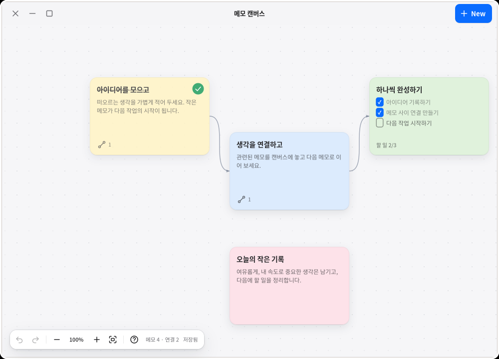
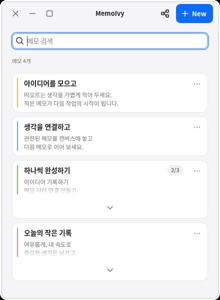

<h1 align="center"> MemoIvy</h1>

<p align="center"><strong>적고 · 묶고 · 연결하는 Linux 메모 앱</strong><br>작은 메모에서, 연결된 생각으로.</p>
<p align="center"><a href="#시작하기">시작하기</a> · <a href="#화면-살펴보기">화면 살펴보기</a> · <a href="https://github.com/pollux-o4/MemoIvy/issues">문제 제보</a></p>

- **적기** — Markdown·체크리스트·이미지·파일, 독립 편집 창과 자동 저장.
- **모으기** — 목록 검색·본문 펼침, 프로젝트와 하위 프로젝트로 정리.
- **연결하기** — 캔버스 배치·연결·정렬, 변경 되돌리기와 다시 실행.

<p align="center">
  <a href="docs/assets/canvas.png"></a><br>
  <sub>실제 개발 버전 · 합성 메모 · 클릭하면 크게 보기</sub>
</p>

## 시작하기

### Snap 설치·업데이트

[Snap Store에서 설치](https://snapcraft.io/memoivy)하거나 터미널에서 실행하세요. 배포판에 **snapd**가 필요합니다.

```bash
# 처음 설치
sudo snap install memoivy

# 설치된 앱 업데이트
sudo snap refresh memoivy

# 실행
snap run memoivy
```

Snap은 자동 업데이트도 지원합니다. 수동 업데이트 전에는 앱을 정상 종료하고, 완료 후 다시 열어 주세요.

일반 설치에서 Snap으로 바꾸면 데이터 저장 영역이 달라 기존 메모가 자동으로 나타나지 않습니다. 전환 전 **백업·복원**(OPS-002) 절차를 확인하세요.

<details>
<summary>소스에서 실행·설치하기 (개발용)</summary>

Linux 데스크톱에서 사용할 수 있습니다. 소스 빌드에는 **GTK 4.10 이상**과 **mise**가 필요합니다.

```bash
# Ubuntu 시스템 패키지와 Rust 준비
# 시스템 패키지 설치에 sudo 필요
mise bootstrap

# 개발 버전 실행
mise run dev
```

앱 메뉴와 바탕화면에 설치하거나 기존 설치본을 갱신하려면:

```bash
mise run install
```

실행 중인 MemoIvy는 종료한 뒤 다시 열어 주세요.

</details>

## 화면 살펴보기

<details>
<summary><strong>목록</strong> — 메모를 검색하고 본문 펼쳐 읽기</summary>

긴 본문은 목록 안에서 펼치고 접습니다. 관련 메모는 프로젝트로 묶고 하위 프로젝트로 나눕니다.



</details>

<details>
<summary><strong>캔버스</strong> — 메모를 배치하고 다음 작업 연결하기</summary>

카드를 끌어 배치하고 다음 메모를 연결합니다. 여러 카드를 선택해 정렬하거나 간격을 맞추고, 배치·연결·완료 변경을 되돌릴 수 있습니다. 카드를 두 번 누르면 원본 메모가 열립니다.


</details>

<details>
<summary><strong>단축키</strong> — 자주 쓰는 조작 빠르게 확인하기</summary>

| 하고 싶은 일 | 조작 |
| --- | --- |
| 앱·서식 단축키 확인 | `F1` |
| 체크 항목 완료·해제 | 체크박스 클릭 또는 `Ctrl+Enter` |
| 링크 열기 | `Ctrl+클릭` · 마우스를 올리면 실제 주소 표시 |
| Markdown 원문 전환 | `Ctrl+Shift+M` 또는 더보기 메뉴 |
| 캔버스에서 여러 카드 선택 | 빈 곳에서 끌기 |
| 선택한 캔버스 메모 삭제 | `Delete` → 확인 후 삭제 |

</details>

## 개발·검증

Rust · GTK 4 · MIT License

<details>
<summary>빌드·테스트·Snap 패키징 명령</summary>

| 작업 | 명령 |
| --- | --- |
| 포맷·전체 테스트·Clippy | `mise run check` |
| 릴리스 빌드 | `mise run build` |
| Snap 패키지 빌드 | `mise run package:snap` |
| 커밋·푸시 비밀정보 검사 활성화 | `mise install` 후 `mise run hooks:install` |

</details>

상세 안내는 `docs`에서 **설치**(OPS-001), **백업·복구**(OPS-002), **개발 검증**(OPS-003), **아키텍처** 관심사로 찾을 수 있습니다.

[버그 제보·기능 제안](https://github.com/pollux-o4/MemoIvy/issues) · [MIT License](LICENSE)
