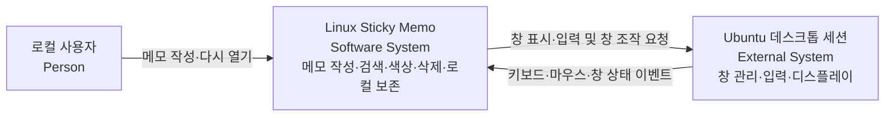

# C1 · 시스템 맥락

[맵 입구](README.md) · [다음: C2](02-containers.md)

로컬 사용자가 Ubuntu 데스크톱에서 여러 메모를 작성·검색·정리하는 시스템이다. 계정 서버나 클라우드 동기화 시스템은 없다.

GTK/GDK와 운영체제 파일 API는 구현 기반이다. C1에서 별도 비즈니스 시스템처럼 나열하지 않고, 실행·저장 경계는 [C2](02-containers.md)에서 설명한다. 실제 GNOME/Wayland·IME 검증 범위는 프로젝트 README를 따른다.
