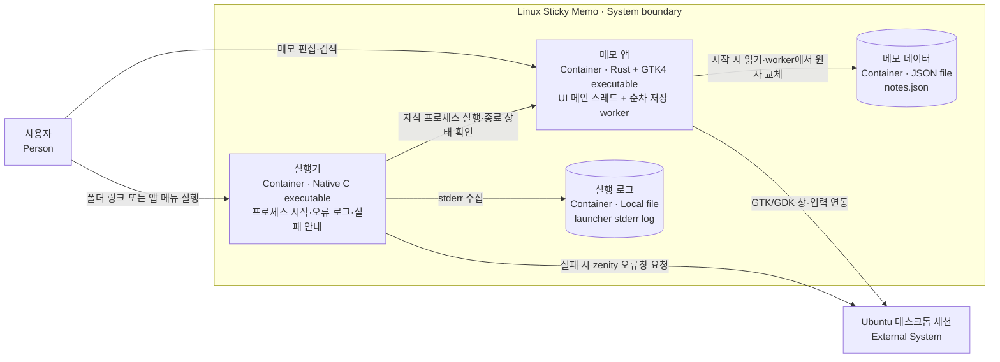

# C2 · 실행·저장 단위

[상위: C1](01-context.md) · [UI 내부](03-ui-components.md) · [저장 내부](03-persistence-components.md)

| 단위 | 구현과 역할 |
|---|---|
| 실행기 | [launcher.c](../integration/launcher.c). 앱과 별도 실행 파일·프로세스이며, 직접 앱 실행 시에는 거치지 않는다. |
| 메모 앱 | [main.rs](../src/main.rs) → `app::run`. GTK와 저장 worker가 같은 프로세스에 있다. |
| 메모 데이터 | XDG_DATA_HOME이 유효한 절대 경로이면 그 아래 `linux-sticky-memo/notes.json`, 아니면 HOME 아래 `.local/share/linux-sticky-memo/notes.json`. [경로 구현](../src/paths.rs)이 원본이다. |
| 실행 로그 | 실행기가 HOME 아래 `.local/share/linux-sticky-memo-launch.log`로 stderr를 연결한다. 메모 저장소와 별개다. |

worker 스레드, Rust 모듈, 내장 SVG와 CSS는 별도 컨테이너가 아니다. GTK/GDK·GLib·D-Bus는 데스크톱 연동 기반이며 앱의 별도 백엔드 서버를 의미하지 않는다. 설치 항목과 링크의 고정 경로는 [설치 스크립트](../integration/install.sh)에서 관리한다.
