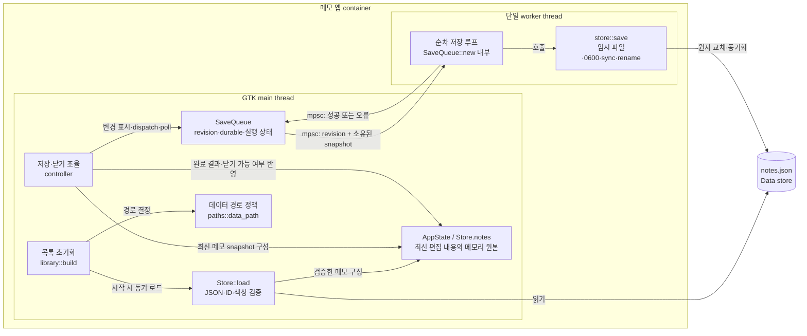

# C3 · 저장 컴포넌트와 스레드 경계

[상위: C2](02-containers.md) · [C4: 저장 코드](code/persistence.md)

## 저장 계약

- 입력 callback은 메모리와 예약 상태를 바꾼다. 디스크 I/O는 worker가 실행한다. debounce와 목록 갱신 시점은 controller의 책임이다.
- 저장 진행 중인 snapshot과 현재 편집 내용은 구별된다. 과거 revision 저장 성공이 더 최신 변경을 저장 완료로 만들지 않도록 `SaveQueue`가 durable revision을 관리한다.
- 생성·삭제는 일반 저장과 구별되는 작업으로 조율한다. 현재 구현은 transaction 결과 표식으로 `u64::MAX`를 사용한다. DB 트랜잭션이 있다는 뜻은 아니다.
- 닫기는 미완료 저장이 있으면 대기한다. 저장 실패 시 편집과 재시도를 유지하며, 원본 로드 실패를 빈 파일로 덮어쓰지 않는다.
- `store::COLORS`는 기본값·로드 검증·팔레트에서 공유하는 색상 목록이다. JSON 스키마와 저장 내구성 구현은 저장 코드 라우팅을 따른다.

이 뷰의 채널은 프로세스 내부 통신이다. 네트워크·클라우드·별도 저장 서버는 없다.
