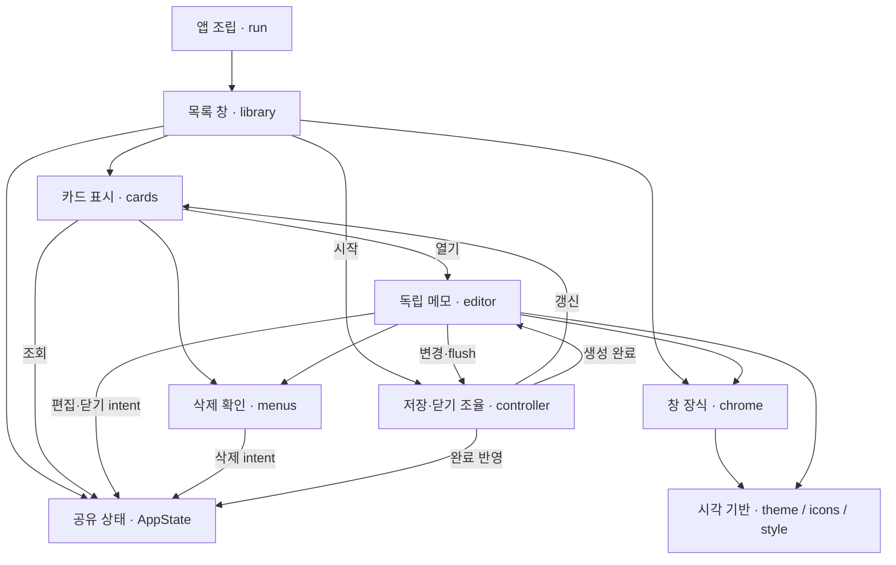

# C3 · UI 컴포넌트

- 뷰와 controller는 GTK 스레드의 AppState를 공유한다. 뷰가 본문·색상·작업 intent를 직접 변경한다.
- 실패 표시는 `AppState::save_failed`, 편집 상태는 `EditorWindow::show_status`에서 공통 처리한다.
- 책임 분리 근거: ADR-0007. 저장 쪽 확장 뷰는 C3 persistence로 찾는다.
