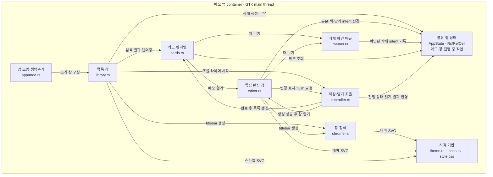

# C3 · 메모 앱의 UI 컴포넌트

[상위: C2](02-containers.md) · [C4: UI 코드](code/ui.md)

다음은 메모 앱 컨테이너 내부의 주요 동작 의존 관계다. 모든 `use` 구문을 재현하는 import 그래프는 아니다.

- `AppState`는 GTK 메인 스레드에서만 접근한다. worker에 GTK 객체나 `Rc<RefCell<_>>`를 전달하지 않는다.
- 현재 뷰는 공유 상태의 본문·색상·작업 intent를 직접 바꾼다. 모든 변경이 controller 메서드만 거치는 엄격한 MVC 구조라고 주장하지 않는다.
- controller는 저장 결과, 생성·삭제 완료, 닫기 대기를 조율한다. `EditorWindow::show_status`와 `AppState::save_failed`는 상태 표시와 실패 복구의 공통 처리다.
- 시각 기반은 Rust 라이브러리와 내장 자산으로 구성된다. 운영체제의 별도 서비스가 아니다. [기반 코드 라우팅](code/platform.md)을 참고한다.

저장 큐와 파일의 내부 관계는 [저장 컴포넌트 뷰](03-persistence-components.md)에서 확장한다.
