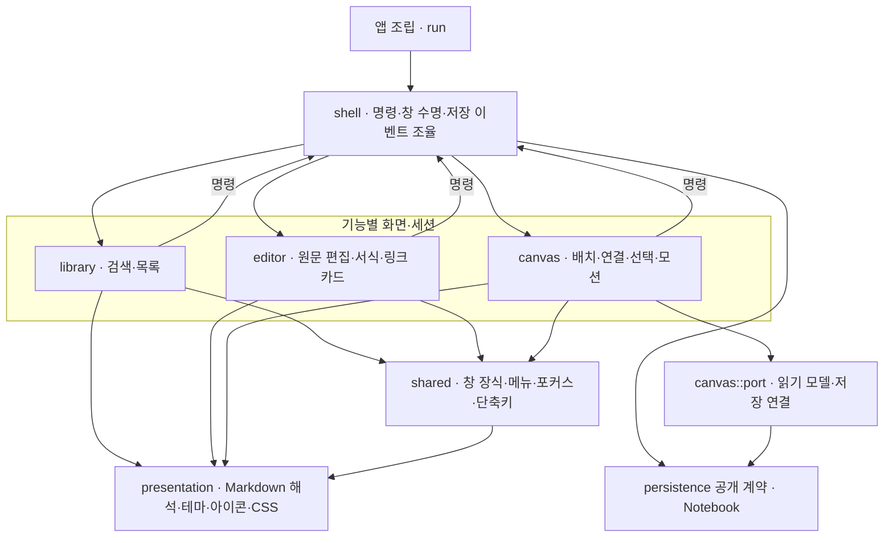

# C3 · UI 컴포넌트

- `AppState`는 `Notebook`과 `Views`를 소유한다. `Closing`과 삭제 대기열은 저장 결과에 맞춰 창 종료·다음 삭제를 진행한다.
- 편집 원문은 `TextBuffer`에 두고 서식·목록 표식·링크 카드를 파생시킨다. 캔버스는 `port`의 읽기 모델로 카드와 패널을 구성한다.
- GTK 독립 Markdown 해석·요약은 편집기와 캔버스가 공유한다. 표식 기호는 같은 상수, 체크 색·테두리는 공통 CSS 선택자를 쓴다.

기능 간 조율·저장 경계: ADR-0010. 캔버스 상호작용 설계: ADR-0009.
