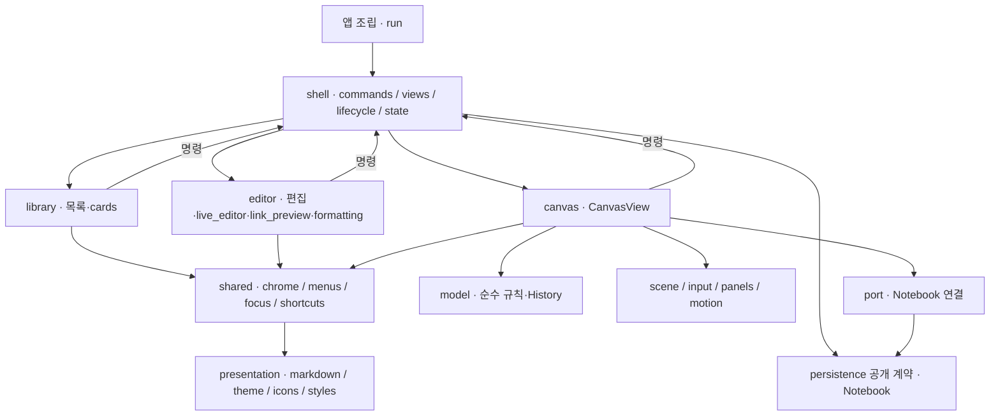

# C3 · UI 컴포넌트

- 기능 모듈끼리 직접 호출하지 않는다. shell은 창 열기·갱신·닫기를 조율하고 Notebook 이벤트를 화면에 반영한다.
- AppState는 Notebook과 Views를 소유한다. Views는 목록 위젯·편집 창·캔버스를 묶고 Closing은 닫기 상태를 표현한다.
- CanvasWidgets는 위젯, BoardSession은 선택·카메라·표시 상태, History는 undo·redo를 맡는다. model은 GTK를 모른다.
- 본문 서식은 presentation::markdown으로 파싱하고 editor에서 적용한다. 카드 크기·초기 배치·색상 문구는 프런트 소유다.
- 저장 폴링과 화면 전환 콜백은 할 일이 있을 때만 유지한다. 모션 줄이기에서는 즉시 전환한다.

책임·경계: ADR-0007, ADR-0009, ADR-0010. 동작·모션: CANVAS-001, CANVAS-002, CANVAS-003.
